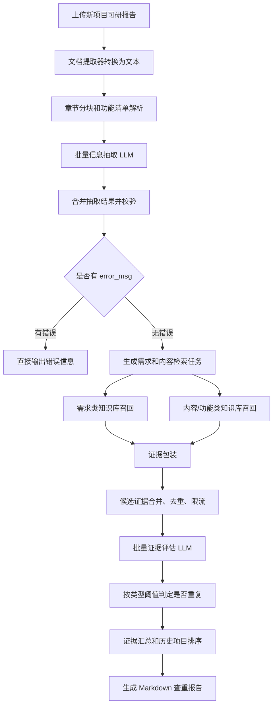

# 项目查重工作流汇报材料

## 1. 一句话概括

项目查重工作流用于对新上传的可行性研究报告进行自动化查重。它先从新项目报告中抽取项目需求、项目目标、项目成果、项目内容和设计开发类功能清单，再到历史项目知识库中召回相似片段，最后由大模型进行语义相似度评估，并由规则节点按固定阈值生成可追溯的 Markdown 查重报告。

核心特点是：知识库检索只负责召回候选，不直接判重；大模型负责语义理解和相似度评分；最终结论由代码节点按统一阈值、统一证据格式输出，保证结果可解释、可复核、可持续优化。

## 2. 建设背景

历史可研报告数量逐步增加后，人工查重主要面临几个问题：

- 人工逐份比对工作量大，效率不稳定。
- 可研报告章节多、篇幅长，重复点可能分散在需求、目标、成果、建设内容和功能清单中。
- 传统关键词检索容易漏掉语义相近但表述不同的内容，也容易把同领域、同系统、同技术路线误判为重复。
- 领导和评审人员不仅需要结论，还需要知道重复在哪里、对应哪个历史项目、证据片段是什么。
- 不同人员判断尺度不完全一致，需要一套相对稳定的判定标准和输出格式。

因此，本项目采用“规则解析 + 知识库召回 + 大模型语义评估 + 阈值判定”的组合方案，在保证效率的同时保留证据链，便于人工复核。

## 3. 建设目标

本工作流主要目标包括：

- 自动识别新项目可研报告中的关键查重对象。
- 对历史项目知识库进行语义召回，减少人工翻查范围。
- 区分“需求重复”“项目内容重复”“新增功能重复”和“非新增功能高相似提示”。
- 输出结构化、可读、可复核的查重报告。
- 将判重规则固化到代码节点中，降低人工判断差异。
- 支持后续通过测试样例、阈值调整和知识库重建持续优化准确率。

## 4. 总体思路

整体思路可以拆成四层：

1. 文档结构化

先把可研报告从整篇长文档拆成可处理的章节块，识别项目名称、需求章节、目标成果章节、项目内容章节和功能清单。

2. 候选召回

把抽取出的关键内容转成检索 query，到历史项目知识库中召回少量候选片段。这里强调“找候选”，不直接给最终结论。

3. 语义评估

把新项目内容和历史候选片段交给大模型，让模型判断业务目标、建设内容、功能能力和成果是否实质相似，并给出综合相似度和证据引用。

4. 规则判重

代码节点根据内容类型设置不同阈值。达到阈值的计入重复，未达到阈值的保留为评估明细，非新增功能高相似只做重点标注。

## 5. 技术路线

技术路线采用 Dify 工作流编排，结合知识库检索、代码节点和 LLM 节点实现。

主要技术组成：

- Dify 工作流：负责任务编排、文件输入、文档提取、知识库检索、节点流转和最终输出。
- Dify 知识库：存放历史项目可研报告切分后的片段。
- 向量检索 + 关键词检索：当前使用加权检索，向量权重 0.7，关键词权重 0.3。
- Embedding 模型：当前工作流配置为 `text-embedding-v4`。
- LLM 信息抽取：从章节块中抽取需求、目标、成果和项目内容。
- LLM 证据评估：对新项目内容和历史候选片段进行语义相似度判断。
- Python/代码节点：负责章节识别、功能清单解析、数据清洗、去重、批处理、阈值判定和报告生成。
- 本地测试页：`查重测试.html` 用于上传 DOCX、执行工作流、观察节点进度、复制和下载结果。
- 批量脚本：用于历史知识库文件上传、工作流稳定性批量测试和知识库分块重建。

当前依据：

- 应用名：`项目查重`
- 工作流版本：`draft`
- 当前匹配版本时间：`2026-07-21 03:38:24.306508`
- 历史项目知识库 ID：`b9dd47fb-6534-4013-ad22-2d1b13ae15f6`

## 6. 端到端流程

## 7. 实现方式

### 7.1 历史知识库准备

历史知识库不是简单把整篇文档上传进去，而是按照查重目标重建分块。

知识库构建脚本 `dev/rag/build_project_kb_chunks.py` 主要做这些事情：

- 支持 `.docx` 和 `.txt` 历史可研报告。
- 从 Word 文档 XML 中提取段落和表格文本。
- 尝试恢复 Word 自动编号标题，避免正文标题缺编号导致章节路径丢失。
- 识别项目名称，无法从正文识别时从文件名推断。
- 按章节路径筛选需要进入知识库的内容。
- 保留需求、项目目标、预期成效、预期成果、项目内容、建设内容等关键章节。
- 跳过集成需求、非功能需求、技术方案、系统实施、培训内容等通用章节。
- 按自定义分隔符输出 TXT，方便 Dify 按固定边界分段。

这样做的目的，是让历史知识库的分块粒度和新项目工作流里的分块粒度保持一致，减少“新项目按章节查，历史库却按随机段落命中”的问题。

### 7.2 新报告解析

用户上传新项目 DOCX 后，Dify 文档提取器先把文档转换为纯文本。随后“章节分块”代码节点进行结构化处理：

- 统一换行格式。
- 恢复自动编号标题。
- 从正文前部识别正式项目名称。
- 判断是否属于“设计开发项目”。
- 根据章节标题和章节路径识别需求类、内容类分块。
- 对长章节按约 12000 字符切分。
- 对设计开发类项目解析功能清单。

章节分块输出的核心字段包括：

- `batches`：给信息抽取 LLM 的分块批次。
- `expected_chunk_ids`：理论上必须被模型处理的 chunk。
- `must_extract_requirement_ids`：必须抽取出需求内容的 chunk。
- `chunk_sources`：chunk 原文、章节路径和抽取模式。
- `project_name`：项目名称。
- `is_design_development_project`：是否为设计开发类项目。
- `function_items`：代码解析出的功能清单。

### 7.3 功能清单解析

设计开发类项目通常会在可研报告中列出系统开发功能清单。这里没有完全交给 LLM 抽取，而是用代码规则解析，原因是功能清单通常是表格或编号标题，结构稳定，规则解析更可控。

当前支持两类来源：

- 表格：识别类似“表 X 本期系统开发功能清单表”的表格，读取一级功能、二级功能、三级功能、功能点说明和状态。
- 编号标题：当没有标准功能清单表时，识别带有“新增、非新增、完善、优化、改造”等状态标记的编号标题。

处理策略：

- “新增”功能达到阈值后计入重复。
- “非新增、完善、优化、改造”等非新增功能不直接计入重复，只在相似度较高时进入重点标注。
- 涉及接口、对接、系统集成、数据交换等通用集成内容会被过滤，降低误判。

### 7.4 信息抽取

批量信息提取 LLM 负责从章节块中抽取结构化信息。

抽取内容包括：

- 需求内容
- 项目目标
- 项目成果
- 项目内容

抽取要求：

- 每个输入 chunk 必须写入 `processed_chunk_ids`。
- 尽量抽取原文连续片段，避免总结、改写、补充。
- `extract_mode=requirement` 时只输出需求类结果。
- `extract_mode=project_content` 时只输出内容类结果。
- 功能清单不由该节点抽取，避免模型对表格结构理解不稳定。

### 7.5 抽取结果合并和校验

信息抽取后，代码节点统一合并所有批次结果，并进行质量校验：

- 检查模型是否漏处理应处理的 chunk。
- 检查必须抽取需求的 chunk 是否形成有效结果。
- 尝试把模型输出恢复为原文片段。
- 合并代码解析出的功能清单。
- 对需求、项目内容、功能清单去重。
- 如果项目名称缺失、模型漏处理或需求抽取缺失，则直接输出错误信息，不进入查重。

当前实现中，代码仍保留“模型输出恢复原文片段”的逻辑；但“模型输出不是原文连续摘录”暂时不阻断流程，用于提高实际运行容错性。

### 7.6 检索任务生成

合并后的结构化数据会被转换为两类检索任务：

- `xmxq`：需求类任务，包括需求内容、项目目标、项目成果。
- `xmnr`：内容类任务，包括项目内容；如果是设计开发项目，还包括功能清单。

每条任务会保留：

- 任务类型：需求、内容或功能。
- 来源字段：需求内容、项目目标、项目成果、项目内容、功能清单。
- 待查重内容。
- 新项目出处章节和表格。
- 功能状态。
- 新项目名称。

生成 query 时会过滤纯标题、表格分隔线、只有序号的行、过短无业务含义的碎片，减少无效检索。

### 7.7 知识库召回

需求类和内容类分别进入知识库检索分支。当前检索配置如下：

| 配置项 | 当前值 |
| --- | --- |
| 历史知识库 | `b9dd47fb-6534-4013-ad22-2d1b13ae15f6` |
| Top K | `4` |
| 检索阈值 | `0.6` |
| 向量权重 | `0.7` |
| 关键词权重 | `0.3` |
| 向量模型 | `text-embedding-v4` |
| Rerank | 关闭 |

这里的检索分只代表召回相关度，不代表最终重复度。最终是否重复仍由后续语义评估和阈值规则决定。

### 7.8 证据包装和候选压缩

知识库命中后，证据包装节点会补齐统一字段：

- 新项目待查重内容。
- 新项目出处。
- 历史项目名称。
- 历史文档名称。
- 历史命中片段。
- 历史章节路径。
- Segment ID。
- 检索分。

随后候选证据批处理节点会做压缩：

- 合并需求分支和内容分支。
- 跳过没有命中片段的任务。
- 按任务和内容去重。
- 按历史项目和历史文档聚合候选。
- 每批最多 5 个任务。
- 每批最多约 16000 字符。
- 每个任务最多保留 3 个候选。
- 每个候选最多保留 2 个命中片段。
- 单个命中片段最多 1200 字符。

这样可以减少 LLM 调用次数，同时控制上下文长度和运行成本。

### 7.9 语义评估

批量证据评估 LLM 会对每个“新项目内容 + 历史候选项目”进行判断，并输出：

- 是否实质相关。
- 综合相似度，范围 0 到 100。
- 证据引用。
- 判断理由。

模型重点判断：

- 业务目标是否重合。
- 建设内容是否重合。
- 功能能力是否重合。
- 项目成果是否重合。

明确不计为重复的情况：

- 只是同领域。
- 只是同系统名称。
- 只是同技术路线。
- 只是通用管理流程相似。
- 只是接口、集成、对接、数据交换等通用内容相似。

### 7.10 阈值判重

LLM 只负责评分，不直接决定最终结论。最终判重由代码节点统一完成。

当前规则如下：

| 内容类型 | 判重阈值 | 处理方式 |
| --- | --- | --- |
| 需求内容 | `>= 60` | 计入重复 |
| 项目目标 | `>= 70` | 计入重复 |
| 项目成果 | `>= 70` | 计入重复 |
| 项目内容 | `>= 60` | 计入重复 |
| 新增功能 | `>= 70` | 计入重复 |
| 非新增功能 | `> 70` | 不计入重复，只做重点标注 |

这个设计体现了不同内容类型的判断尺度：

- 需求和项目内容更容易出现实质重合，因此阈值相对低一些。
- 项目目标、项目成果通常更概括，需要更高相似度才计入重复。
- 新增功能代表新建能力，重复风险更高。
- 非新增功能更多是完善、优化和改造，不能简单等同于重复。

### 7.11 报告生成

最终报告为 Markdown 格式，包含：

1. 查重结论。
2. 重复项目名称。
3. 全量重复明细。
4. 项目需求重复点。
5. 项目内容重复点。
6. 重复功能清单。
7. 重点标注。

结论规则是：只要存在一条 `is_duplicate=true` 的证据，最终结论就是“重复”；否则为“不重复”。

报告不仅输出结论，还输出新项目出处、历史项目名称、命中片段、综合相似度和是否重复，便于领导或评审人员复核。

## 8. 关键设计取舍

### 8.1 为什么不用单纯关键词查重

可研报告中很多重复不是字面重复，而是业务目标、建设内容或功能能力相似。单纯关键词查重容易漏掉“换一种说法”的重复，也容易把同领域通用词误判为重复。

因此本方案用向量检索解决语义召回，用 LLM 解决语义判断。

### 8.2 为什么检索不直接判重

知识库检索分只说明“像不像、能不能召回”，不能说明“是否实质重复”。例如两个项目都提到数据分析、系统管理、接口对接，检索分可能较高，但不一定重复。

所以工作流把检索定位为候选召回，把判重放到后面的 LLM 评估和代码阈值节点。

### 8.3 为什么要用代码节点做校验和判定

LLM 适合理解语义，但不适合承担全部规则控制。代码节点更适合做稳定、可审计的工作：

- 章节规则识别。
- 功能清单解析。
- 批次控制。
- 去重。
- 漏处理检查。
- 阈值判定。
- 报告格式生成。

这能降低模型不稳定带来的影响。

### 8.4 为什么功能清单优先用代码解析

功能清单通常是表格或编号标题，结构明确。用代码解析可以保留功能名称、功能描述、功能状态和来源表格，避免 LLM 把表格内容改写、漏列或合并。

### 8.5 为什么要分需求、内容和功能

不同对象的重复含义不同：

- 需求重复说明新项目要解决的问题可能和历史项目重合。
- 项目内容重复说明建设范围和实施内容可能重合。
- 新增功能重复说明具体系统能力可能已经建设过。
- 非新增功能高相似通常只能提示关注，不应直接作为重复结论。

分类型处理可以让结论更细，也便于人工复核。

## 9. 测试与验证

### 9.1 自动化测试覆盖

当前已有 `dev/rag/test_build_project_kb_chunks.py`，主要覆盖知识库重建和章节分块的关键逻辑：

- 从目录恢复正文自动编号标题。
- DOCX 自动编号标题恢复后保留六级章节路径。
- 需求章节、项目目标、项目内容章节分类正确。
- 集成需求等通用章节会被跳过。
- 项目内容中的说明文字和功能表格在长度允许时保持在同一分块。
- 长表格切分时，首段保留上下文说明和第一批表格行。
- 知识库分块输出只嵌入章节路径上下文，不额外污染项目名称、来源文档、内容类型等字段。

本轮轻量验证情况：

- `pytest` 命令不可用。
- `uv` 命令不可用。
- 已通过 `python3` 直接调用 5 个测试函数进行 smoke run。
- 结果：`direct test function smoke run passed: 5/5`。

说明：该结果能证明核心样例函数在当前环境可执行，但不等价于完整 pytest 环境。正式交付前建议在具备依赖的开发环境或 CI 中执行完整测试命令。

### 9.2 工作流 API 联调

已有 `dify_项目查重.py` 作为批量稳定性测试脚本，主要验证：

- 本地 DOCX 批量遍历。
- 文件上传到 Dify。
- 通过工作流 API 执行查重。
- 记录执行失败的文件路径和错误信息。

该脚本适合用于批量跑样本，观察不同报告模板下的稳定性和错误原因。

### 9.3 测试页面验证

已有 `查重测试.html` 测试页，主要验证端到端使用链路：

- 填写工作流运行地址。
- 选择 DOCX 文件。
- 获取 passport。
- 自动读取工作流参数并识别文件变量。
- 上传文件。
- 执行项目查重工作流。
- 解析 SSE 事件。
- 展示工作流节点进度。
- 渲染 Markdown 结果。
- 支持停止任务、复制结果、下载 TXT。

该测试页适合给业务侧演示，也适合排查“文件上传、工作流运行、节点返回、结果展示”链路问题。

### 9.4 知识库构建验证

知识库侧有两类脚本：

- `dev/rag/build_project_kb_chunks.py`：用于把历史可研报告按查重逻辑重建为 TXT 分块。
- `dify-知识库文件上传.py`：用于批量上传文档到 Dify 知识库。

验证重点包括：

- 历史文档能否正确读取。
- 章节路径是否准确。
- 是否只保留和查重相关的需求、目标、成果、内容章节。
- 通用集成、实施、培训、技术方案内容是否被过滤。
- 分块粒度是否适合 Dify 知识库检索。
- 上传后知识库是否完成索引。

### 9.5 建议补充的验收指标

为了给领导汇报更有说服力，建议补充以下量化指标：

| 指标 | 建议口径 |
| --- | --- |
| 历史知识库规模 | 已纳入多少份历史可研报告，生成多少个有效分块 |
| 单篇平均耗时 | 选取固定样本，记录平均执行时间和最长耗时 |
| 召回有效率 | 抽样检查知识库命中片段是否与新项目内容相关 |
| 重复判断准确率 | 与人工复核结果对比，统计一致比例 |
| 漏判案例数 | 人工发现重复但系统未提示的案例 |
| 误判案例数 | 系统提示重复但人工认为不重复的案例 |
| 错误中断率 | 批量运行中因项目名称缺失、模型漏处理等导致失败的比例 |
| 报告可复核性 | 抽样检查报告是否包含足够的历史项目和证据片段 |

## 10. 当前效果

从实现效果看，工作流已经具备以下能力：

- 可以从新上传可研报告中自动抽取查重所需的关键内容。
- 可以把长文档拆成需求、目标、成果、项目内容和功能项等更细粒度对象。
- 可以通过历史知识库召回候选项目片段，减少人工逐篇翻找。
- 可以对候选证据做语义相似度评估，避免只看关键词。
- 可以按不同类型设置判重阈值，减少“一刀切”误判。
- 可以输出重复项目排名、全量评估明细、需求重复点、内容重复点和功能重复点。
- 可以对非新增功能高相似情况做重点标注，而不是直接判重复。
- 可以通过测试页完成端到端演示和排查。

对管理侧的价值：

- 提升查重效率，把人工从全文翻查转为重点复核。
- 提升判断一致性，让重复判定有固定阈值和固定格式。
- 增强可追溯性，每个结论都有历史项目、命中片段和相似度。
- 支持快速发现项目立项内容与历史建设内容的重叠风险。
- 便于后续形成项目入库、申报前预审、评审辅助等流程化能力。

## 11. 当前边界

当前方案仍有一些边界需要说明：

- 结果依赖历史知识库覆盖范围。历史库没有的内容无法被召回。
- 结果依赖历史知识库分块质量。分块过粗或过碎都会影响召回和评估。
- 如果更换 embedding 模型，历史知识库需要重新嵌入，否则检索分可能异常。
- 不同可研模板的章节标题差异可能导致章节识别不完整。
- 项目名称识别依赖正文前部的“项目名称：xxx”格式，异常模板可能识别失败。
- 当前“模型输出不是原文连续摘录”已临时放行，提升了容错性，但严格审计时需要考虑是否恢复阻断。
- 只要有一条证据达到阈值，最终结论就是重复，因此边界案例需要人工复核。
- 上传文档如果已经在历史知识库中，可能产生自命中，需要增加同名项目或同名文档过滤。
- LLM 评估存在一定不确定性，建议对接近阈值的结果进行人工复核。

## 12. 风险和应对

| 风险 | 表现 | 应对方式 |
| --- | --- | --- |
| 历史知识库覆盖不足 | 查不到实际重复项目 | 持续补充历史可研，建立入库规范 |
| 文档模板差异大 | 章节识别失败或漏抽 | 扩展章节识别规则，沉淀异常模板样例 |
| 检索召回不准 | 候选片段无关或漏召回 | 调整阈值、Top K、分块粒度和关键词权重 |
| LLM 抽取漏处理 | 提示模型未处理分块 | 缩小批次、优化提示词、增加重试策略 |
| LLM 误评分 | 相似度接近阈值时误判 | 增加人工复核标记和边界区间 |
| 自命中 | 新上传文件与历史库同文档匹配 | 增加同名项目、同名文档或上传批次过滤 |
| 报告信息不足 | 领导难以判断依据 | 增加历史文档名、章节路径、检索分、理由字段 |
| 运行耗时较长 | 大文档或候选多时等待久 | 批量压缩、限制候选数、观察模型节点耗时 |

## 13. 后续优化建议

建议按优先级推进：

1. 增加自命中过滤

过滤同名项目、同名文档或当前上传文档，避免历史库中已有同一份文件时被直接判重。

2. 增加运行诊断信息

在报告或调试输出中增加：抽取 chunk 数、需求任务数、内容任务数、召回为空任务数、进入评估任务数、批次数、总耗时。

3. 优化报告字段

在全量明细中补充历史文档名、历史章节路径、检索分和模型判断理由，提升审计价值。

4. 建立人工复核样本集

沉淀一批“重复、疑似重复、不重复、误判、漏判”样本，用于调阈值和回归测试。

5. 完善章节模板规则

针对不同可研模板补充章节识别规则，例如“建设方案 > 工作内容”“业务应用建设内容”等。

6. 增加边界区间

例如相似度在阈值上下 5 分内标记为“建议人工复核”，避免边界案例被过度自动化。

7. 恢复或分级处理原文摘录校验

可以把“模型输出不是原文连续摘录”从阻断改为告警，或在正式审计模式下恢复阻断。

8. 知识库定期重建机制

当历史文档更新、embedding 模型变化或分块规则变化时，建立知识库重建流程和版本记录。

## 14. 给领导汇报口径

可以按下面这段口径汇报：

我们做的项目查重工作流，主要解决可研报告人工查重效率低、判断标准不统一、证据难追溯的问题。整体方案不是简单关键词匹配，而是先把新项目报告按章节拆解成需求、目标、成果、项目内容和功能清单，再到历史项目知识库中召回候选证据，最后由大模型判断语义相似度，并由代码节点按统一阈值输出查重结论。

这套方案的特点是把模型和规则结合起来：模型负责理解语义，规则负责章节识别、质量校验、候选控制、阈值判定和报告生成。最终报告会给出是否重复、重复项目名称、重复证据明细、需求重复点、内容重复点和功能重复点，领导和评审人员可以直接看到判断依据。

目前工作流已经实现了 DOCX 上传、文本提取、章节分块、功能清单解析、历史知识库召回、批量相似度评估、阈值判重和 Markdown 报告输出，也配套了测试页面、批量运行脚本和知识库分块脚本。下一步重点是补充人工复核样本集、完善量化指标、增加自命中过滤和运行诊断信息，把它从可用提升到更适合长期运营。

## 15. 附录：关键文件

| 文件 | 作用 |
| --- | --- |
| `项目查重工作流介绍.md` | 当前工作流技术介绍文档 |
| `dev/rag/project_dedup_workflow.py` | 恢复出的 Dify 项目查重 draft 工作流代码节点逻辑 |
| `dev/rag/build_project_kb_chunks.py` | 历史项目知识库分块重建脚本 |
| `dev/rag/test_build_project_kb_chunks.py` | 知识库分块和章节识别测试 |
| `dify-知识库文件上传.py` | 批量上传文件到 Dify 知识库的辅助脚本 |
| `dify_项目查重.py` | 批量上传 DOCX 并执行项目查重工作流的稳定性测试脚本 |
| `查重测试.html` | 本地端到端测试页面 |

## 16. 附录：最终报告字段解释

| 报告模块 | 含义 |
| --- | --- |
| 查重结论 | 有任意重复证据则为重复，否则不重复 |
| 重复项目名称 | 按历史项目聚合重复证据，展示排名和证据数 |
| 全量重复明细 | 展示所有有效评估证据，包括未达到重复阈值的记录 |
| 项目需求重复点 | 汇总需求内容、项目目标、项目成果中的重复点 |
| 项目内容重复点 | 汇总项目内容和新增功能中的重复点 |
| 重复功能清单 | 单独列出新增功能中判重的功能项 |
| 重点标注 | 非新增功能高相似但不计入重复的提示 |

## 17. 附录：建议补充到汇报 PPT 的页面

如果后续要做 PPT，可以按这几页展开：

1. 背景痛点：人工查重效率低、标准不一致、证据难追溯。
2. 建设目标：自动抽取、自动召回、语义评估、证据报告。
3. 技术路线：规则解析 + 知识库检索 + 大模型评估 + 阈值判定。
4. 工作流总览：上传、分块、抽取、召回、评估、报告。
5. 核心能力：需求查重、内容查重、功能清单查重、重点标注。
6. 测试验证：自动化用例、批量脚本、测试页面、样本复核。
7. 应用效果：效率提升、标准统一、结果可追溯、辅助评审。
8. 后续计划：样本集、量化指标、自命中过滤、诊断信息、知识库治理。
